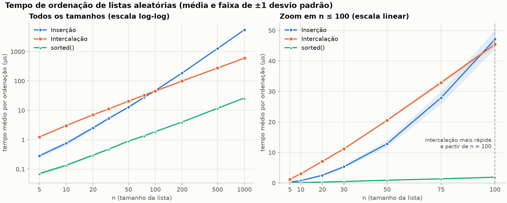
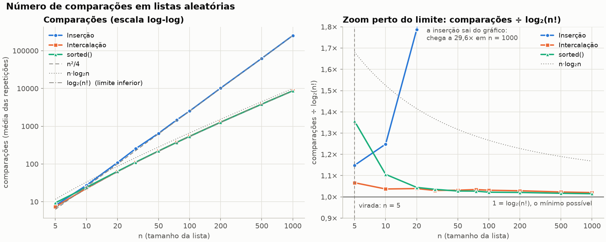
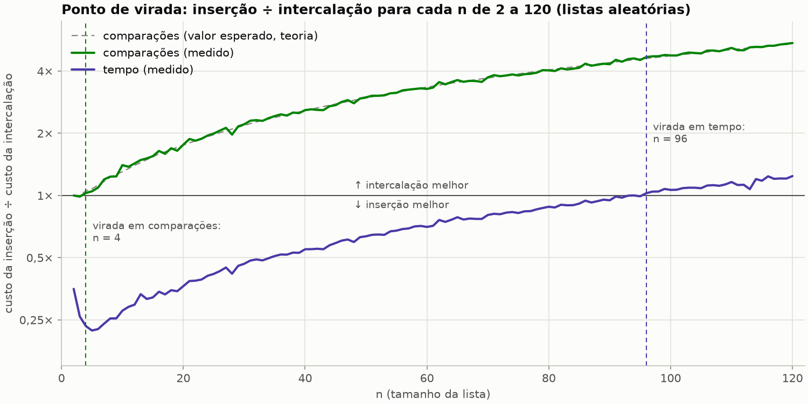
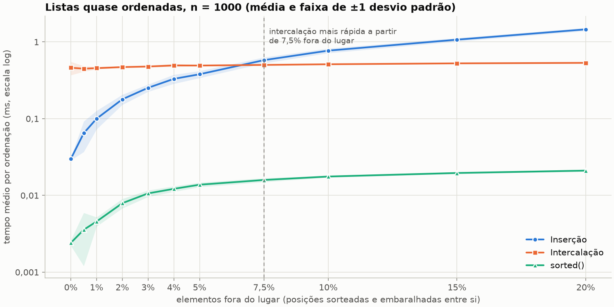

# Relatório: ordenação por inserção × ordenação por intercalação

Todos os números deste relatório vêm de `dados.csv`, `dados_virada.csv` e
`dados_quase_ordenada.csv`, gerados por `python medir.py` (semente 2026, 30
repetições) em um **Apple M4, 16 GB, macOS 26.6.2, Python 3.14.5**. Os tempos
mudam de máquina para máquina; as comparações da inserção e da intercalação não
(seção 1.4).

## Respostas curtas

| Pergunta | Resposta |
|---|---|
| A partir de que n a intercalação fica mais rápida? | Entre os tamanhos pedidos, **n = 100** (em 75 a inserção ainda ganha; em 100 é quase empate: 47,1 µs contra 45,5 µs). Medindo n de 1 em 1: **n ≈ 95** (a razão cruza 1 em 94 e não volta para baixo de 1 a partir de 96). |
| Comparações e tempo dão o mesmo ponto de virada? | **Não.** Em comparações a intercalação ganha já a partir de **n = 4**. Em tempo, só perto de **n = 95**, porque cada comparação da intercalação custa cerca de 4,6 vezes mais que uma comparação da inserção. |
| Por que o `sorted()` não serve para decidir? | Ele é outro algoritmo (Timsort) e roda em C. Faz praticamente as mesmas comparações que a intercalação e mesmo assim é 23 vezes mais rápido: a diferença está na implementação, não no algoritmo. |
| Quando a inserção ainda é a escolha certa? | Em listas pequenas (aqui, abaixo de uns 90 elementos) e em listas quase ordenadas. Com n = 1000 e a lista já ordenada, a inserção foi 15 vezes mais rápida que a intercalação. |
| Extra: comparações do `sorted()` | Sempre abaixo de n·log₂n e, a partir de n = 20, no máximo 4,5% acima do mínimo teórico log₂(n!). Em n = 1000: 8.655 comparações, contra 8.529 do limite e 9.966 de n·log₂n. |

---

## 1. Como foi medido

### 1.1 Os algoritmos

Os dois estão em [`ordenacao.py`](ordenacao.py) e seguem a interface do
`sorted()`: aceitam qualquer sequência, devolvem uma lista nova e não alteram a
entrada. Os dois são estáveis e comparam elementos **só com `<`**.

- **Inserção** (`ordenar_por_insercao`): a versão clássica, que desloca para a
  direita os elementos maiores que a chave.
- **Intercalação** (`ordenar_por_intercalacao`): recursiva, de cima para baixo.
  Divide em `n // 2`, ordena as metades e intercala. A intercalação não usa
  sentinela: quando um dos lados acaba, o resto do outro é copiado sem novas
  comparações.

### 1.2 As listas

- Tamanhos: n = 5, 10, 20, 30, 50, 75, 100, 200, 500 e 1000.
- Cada lista tem n inteiros **distintos** sorteados entre 0 e 999.999
  (`random.sample`).
- **30 repetições** por tamanho (a atividade pede pelo menos 10). Cada
  repetição usa uma lista nova, e os três métodos ordenam a mesma lista, em ordem
  sorteada, para nenhum deles rodar sempre primeiro.

### 1.3 Tempo

Uma ordenação de 5 elementos leva cerca de 0,3 µs, perto da resolução do
relógio. Por isso cada repetição ordena a mesma lista várias vezes seguidas, até
somar pelo menos 2 ms, e divide o total pelo número de execuções (coluna
`execucoes` do CSV). Isso é feito com `timeit`, que desliga o coletor de lixo
durante a medição. O valor de cada tamanho é a **média das 30 repetições**,
acompanhada do desvio padrão.

### 1.4 Comparações

As comparações não são contadas por um contador dentro dos algoritmos. Os
elementos são embrulhados em `ElementoContado`, cujo `__lt__` soma 1 a um
contador antes de comparar os valores (é a mesma ideia sugerida no extra para o
`sorted()`). Isso traz três vantagens:

1. o código cronometrado é o código "limpo", sem o custo de um contador;
2. os três métodos, incluindo o `sorted()`, são medidos exatamente do mesmo
   jeito;
3. `<=`, `>=`, `==` e `!=` levantam erro no `ElementoContado`, então nenhuma
   comparação escapa da contagem sem que alguém perceba.

Contam-se as comparações **entre elementos**, como é usual na análise de
algoritmos de ordenação. Comparações de índices (`j >= 0`, `i < len(...)`) não
entram.

A contagem é conferida em [`testes.py`](testes.py) contra resultados exatos:

- inserção em lista ordenada: n − 1;
- inserção em lista invertida: n(n − 1)/2;
- inserção em lista qualquer: inversões + (n − 1) − (número de novos mínimos);
- intercalação em lista ordenada de tamanho 2ᵏ: (n/2)·k;
- intercalação sempre entre o melhor e o pior caso, este igual a n⌈log₂n⌉ − 2^⌈log₂n⌉ + 1;
- a média sobre **todas** as permutações de até 7 elementos bate exatamente
  com as fórmulas de valor esperado da seção 5.

As listas saem de uma semente fixa, então as comparações da inserção e da
intercalação são **as mesmas em qualquer máquina e em qualquer versão do
Python**. Isso foi conferido rodando o mesmo código no Python 3.9.6 do macOS:
200 de 200 linhas iguais. As do `sorted()` mudam um pouco entre versões do
Python (seção 8).

---

## 2. Tempos

Tempo médio por ordenação, em microssegundos (µs), ± desvio padrão das 30
repetições:

| n | Inserção | Intercalação | `sorted()` |
|---:|---:|---:|---:|
| 5 | **0,28** ± 0,04 | 1,25 ± 0,04 | 0,07 ± 0,01 |
| 10 | **0,76** ± 0,12 | 3,02 ± 0,08 | 0,14 ± 0,02 |
| 20 | **2,53** ± 0,32 | 7,07 ± 0,15 | 0,30 ± 0,03 |
| 30 | **5,32** ± 0,51 | 11,18 ± 0,22 | 0,48 ± 0,03 |
| 50 | **12,85** ± 1,07 | 20,54 ± 0,24 | 0,90 ± 0,04 |
| 75 | **27,92** ± 2,06 | 32,91 ± 0,76 | 1,36 ± 0,06 |
| 100 | 47,08 ± 3,10 | **45,45** ± 0,88 | 1,89 ± 0,07 |
| 200 | 186,40 ± 6,70 | **99,75** ± 1,37 | 4,01 ± 0,12 |
| 500 | 1.271,64 ± 42,96 | **276,34** ± 4,27 | 11,80 ± 0,44 |
| 1000 | 5.518,01 ± 118,77 | **597,38** ± 9,57 | 26,31 ± 1,00 |

Em negrito, o mais rápido entre inserção e intercalação.

O crescimento bate com a teoria. De n = 500 para n = 1000 (o dobro), o tempo da
inserção foi multiplicado por **4,3** (≈ 2², quadrático), e o da intercalação por
**2,2** (≈ 2 · log 1000 / log 500 = 2,2, n log n). No gráfico log-log isso
aparece como inclinação 2 para a inserção e pouco mais de 1 para a
intercalação.

---

## 3. Comparações

Média de comparações nas 30 repetições, com o limite inferior teórico log₂(n!) e
a referência n·log₂n:

| n | Inserção | Intercalação | `sorted()` | log₂(n!) | n·log₂n |
|---:|---:|---:|---:|---:|---:|
| 5 | 7,9 | **7,4** | 9,4 | 6,9 | 11,6 |
| 10 | 27,2 | **22,6** | 24,1 | 21,8 | 33,2 |
| 20 | 109,2 | **63,5** | 63,8 | 61,1 | 86,4 |
| 30 | 253,9 | **111,0** | 111,5 | 107,7 | 147,2 |
| 50 | 649,6 | **220,9** | 220,1 | 214,2 | 282,2 |
| 75 | 1.468,3 | **375,9** | 373,2 | 363,4 | 467,2 |
| 100 | 2.524,0 | **541,1** | 536,3 | 524,8 | 664,4 |
| 200 | 10.242,4 | **1.281,2** | 1.271,4 | 1.245,4 | 1.528,8 |
| 500 | 62.681,8 | **3.854,1** | 3.830,8 | 3.767,4 | 4.482,9 |
| 1000 | 252.622,8 | **8.702,1** | 8.655,3 | 8.529,4 | 9.965,8 |

Em negrito, quem compara menos entre inserção e intercalação: a intercalação, em
**todos** os tamanhos pedidos.

As médias medidas batem com os valores esperados exatos (seção 5). Em n = 1000 a
inserção deveria fazer em média 250.742,5 comparações (mediu 252.622,8, 0,75% de
diferença com 30 amostras), e a intercalação 8.707,2 (mediu 8.702,1). A inserção
acompanha n²/4; a intercalação fica entre log₂(n!) e n·log₂n, apenas 2% acima do
mínimo possível em n = 1000.

---

## 4. Em que n a intercalação passa a ser mais rápida

**Entre os tamanhos pedidos: n = 100.** Até n = 75 a inserção é mais rápida
(27,9 µs contra 32,9 µs). Em n = 100 a intercalação já vence, mas por pouco
(45,5 contra 47,1 µs, 3,6%). Daí em diante a diferença só cresce: 1,9 vezes em
n = 200 e 9,2 vezes em n = 1000.

Como a virada fica entre 75 e 100, o `medir.py` faz também uma **varredura de n
em n, de 2 a 120**, com 30 listas por tamanho (`dados_virada.csv`):

| n | tempo inserção ÷ tempo intercalação | listas em que a intercalação foi mais rápida |
|---:|---:|---:|
| 60 | 0,71 | 0% |
| 80 | 0,88 | 7% |
| 88 | 0,94 | 33% |
| 92 | 0,98 | 37% |
| 94 | 1,00 | 50% |
| 96 | 1,03 | 70% |
| 100 | 1,06 | 83% |
| 108 | 1,11 | 93% |
| 120 | 1,24 | 100% |

A razão sobe de forma contínua e cruza 1 em **n ≈ 95** (1,00 em 94, 0,99 em 95
e acima de 1 para todo n ≥ 96). Não é um ponto exato, é uma faixa: entre uns 85
e 115 elementos o vencedor depende de quão desordenada está cada lista. Em
n = 94, cada algoritmo ganhou em metade das listas.

**Esse número vale para esta máquina e esta versão do Python.** Rodando o mesmo
código com o Python 3.9.6 que vem no macOS (modo `--rapido`, 10 repetições), a
virada caiu para entre **n = 62 e 75**: em n = 75 a inserção levou 72,0 µs e a
intercalação 62,4 µs. O formato das curvas não muda: em qualquer máquina a
intercalação acaba vencendo, porque n² cresce mais rápido que n log n. Já o
ponto onde isso acontece depende das constantes, que são o assunto da próxima
seção.

---

## 5. Comparações e tempo dão o mesmo ponto de virada?

**Não.** A diferença é grande: em comparações a intercalação vence a partir de
**n = 4**; em tempo, só a partir de **n ≈ 95**.

### A virada em comparações

Dá para calcular o número médio exato de comparações sobre todas as permutações
(funções `comparacoes_esperadas_*` no `medir.py`, conferidas por força bruta nos
testes):

- **inserção:** n(n − 1)/4 + n − Hₙ. São n(n−1)/4 inversões em média, mais uma
  comparação que para o laço para cada elemento, menos os casos em que o
  elemento é o menor até ali e o laço para por `j < 0`, sem comparar. Hₙ é o
  número harmônico.
- **intercalação:** C(n) = C(⌊n/2⌋) + C(⌈n/2⌉) + n − ⌊n/2⌋/(⌈n/2⌉+1) − ⌈n/2⌉/(⌊n/2⌋+1).
  Intercalar p e q elementos custa p + q menos o que sobra do lado que não
  acabou, e em média sobram p/(q+1) + q/(p+1).

| n | 2 | 3 | 4 | 5 | 6 | 7 | 8 |
|---|---:|---:|---:|---:|---:|---:|---:|
| inserção (esperado) | 1 | 2,67 | 4,92 | 7,72 | 11,05 | 14,91 | 19,28 |
| intercalação (esperado) | 1 | 2,67 | **4,67** | **7,17** | **9,83** | **12,73** | **15,73** |
| inserção (medido, 30 listas) | 1 | 2,67 | 4,83 | 7,30 | 10,70 | 15,23 | 19,33 |
| intercalação (medido, 30 listas) | 1 | 2,70 | 4,70 | 6,97 | 9,80 | 12,73 | 15,67 |

Até n = 3 há empate exato; de n = 4 em diante a intercalação compara menos, e a
vantagem só aumenta. A varredura medida dá a mesma virada (n = 4). Entre os
tamanhos pedidos, que começam em 5, a intercalação compara menos em todos.

### Por que o tempo vira tão mais tarde

Tempo ≈ comparações × custo de cada comparação. O segundo fator é muito
diferente nos dois algoritmos:

| n | Inserção (ns por comparação) | Intercalação (ns por comparação) | razão |
|---:|---:|---:|---:|
| 5 | 35,9 | 169,1 | 4,7 |
| 10 | 27,8 | 133,8 | 4,8 |
| 50 | 19,8 | 93,0 | 4,7 |
| 100 | 18,7 | 84,0 | 4,5 |
| 1000 | 21,8 | 68,6 | 3,1 |

(tempo médio ÷ comparações médias, tabela completa na saída do `medir.py`)

O que acontece a cada comparação em cada algoritmo:

- **Inserção:** o laço interno é `j >= 0`, `chave < a[j]`, `a[j + 1] = a[j]` e
  `j -= 1`. São poucas instruções, sem nenhuma chamada de função e sem criar
  nenhuma lista.
- **Intercalação:** por comparação, duas chamadas de `len()`, duas comparações
  de índice, o `<`, uma chamada de `resultado.append(...)` e o incremento do
  índice. Fora do laço há mais custos que **não são comparações**:
  - os fatiamentos `a[:meio]` e `a[meio:]` copiam a lista inteira em cada nível
    da recursão;
  - cada intercalação cria uma lista nova;
  - há 2n − 1 chamadas recursivas de `_intercalacao` e n − 1 chamadas de
    `_intercalar`. Para ordenar 5 elementos são 13 chamadas de função, e cada
    chamada em Python custa dezenas de nanossegundos.

Por isso o custo por comparação da intercalação é maior em n pequeno: o custo
fixo das chamadas pesa mais quando há poucas comparações para dividir.

Juntando as duas coisas: a intercalação só ganha em tempo quando faz menos
comparações **numa proporção maior** que a diferença de custo por comparação.
Perto de n = 95 essa diferença de custo é de cerca de 86 ns ÷ 19 ns ≈ **4,6**. A
razão de comparações (linha verde no gráfico de virada) chega a 4,6 justamente
em n ≈ 94–96 (4,61 em 94, 4,68 em 96). A virada em tempo cai exatamente onde as
duas razões se encontram.

O experimento com listas quase ordenadas (seção 7) mostra o mesmo fenômeno de
outro ângulo. Com 2% dos elementos fora do lugar, a inserção fez **mais**
comparações que a intercalação (7.364 contra 6.471) e mesmo assim foi 2,6 vezes
mais rápida.

Resumindo: **o número de comparações prevê o formato das curvas** (n² contra
n log n, e por isso a intercalação sempre vence para n grande), **mas não prevê
onde elas se cruzam**. O ponto de cruzamento depende do custo de cada passo, que
depende da implementação, da linguagem e da máquina.

---

## 6. Por que comparar com o `sorted()` não serve para decidir entre os dois

1. **O `sorted()` não é nenhum dos dois algoritmos.** Ele usa o Timsort, um
   híbrido: procura trechos que já estão em ordem, completa os trechos curtos
   até 32–64 elementos com **inserção binária** e depois **intercala** esses
   trechos com uma técnica chamada *galloping*.
2. **Ele roda em C, compilado; as nossas funções rodam no interpretador do
   Python.** Para listas de inteiros, o CPython ainda usa uma comparação
   especializada que nem chama `__lt__`.
3. **Os números mostram que a diferença está na implementação, não no
   algoritmo.** Em n = 1000 o `sorted()` fez 8.655 comparações e a intercalação
   8.702, apenas 0,5% a mais. Mesmo assim o `sorted()` foi **22,7 vezes mais
   rápido** (26,3 µs contra 597,4 µs): 3,0 ns por comparação contra 68,6 ns. Os
   dois algoritmos são quase iguais no que importa para a análise; o que muda é
   C contra Python.
4. **Ele vence os dois em todos os tamanhos**, então não ordena um em relação ao
   outro. Comparar a inserção com o `sorted()` e a intercalação com o `sorted()`
   mede, nos dois casos, o quanto o interpretador do Python é mais lento que C.
   Isso não diz qual dos dois cresce melhor com n nem onde um passa o outro. Para
   decidir entre inserção e intercalação, é preciso compará-los nas mesmas
   condições (mesma linguagem, mesmo estilo de código, mesmas listas), que é o
   que as seções 2 a 5 fazem.

O `sorted()` serve, sim, como referência do que é possível na prática. E o
próprio desenho do Timsort confirma a conclusão deste relatório: inserção para
pedaços pequenos e intercalação para juntar pedaços grandes.

---

## 7. Quando a inserção ainda é a escolha certa

**Caso 1: listas pequenas.** Até n ≈ 93 (nesta máquina), a inserção foi mais
rápida em média, chegando a 4 vezes mais rápida em n = 10 (0,76 µs contra
3,02 µs). Exemplo: ordenar os 10 primeiros colocados
de um ranking. É também por isso que algoritmos "de verdade" passam a usar
inserção quando o pedaço a ordenar fica pequeno: o Timsort do Python faz isso
abaixo de 64 elementos, e o `std::sort` do C++ abaixo de 16.

**Caso 2: listas quase ordenadas.** O custo da inserção é proporcional a
n + (número de inversões), então numa lista quase em ordem ela é praticamente
linear. A intercalação faz o mesmo trabalho de sempre. O `medir.py` testa isso
com n = 1000, partindo de uma lista ordenada e embaralhando entre si os valores
de uma porcentagem das posições (`dados_quase_ordenada.csv`):

| fora do lugar | Inserção (ms) | Intercalação (ms) | `sorted()` (ms) | comparações inserção | comparações intercalação |
|---:|---:|---:|---:|---:|---:|
| 0% | **0,030** | 0,461 | 0,002 | 999 | 4.932 |
| 0,5% | **0,065** | 0,448 | 0,004 | 2.327 | 5.534 |
| 1% | **0,100** | 0,456 | 0,005 | 3.982 | 5.936 |
| 2% | **0,179** | 0,470 | 0,008 | 7.364 | 6.471 |
| 5% | **0,379** | 0,492 | 0,014 | 16.201 | 7.086 |
| 7,5% | 0,579 | **0,502** | 0,016 | 25.325 | 7.388 |
| 20% | 1,459 | **0,534** | 0,021 | 65.141 | 8.041 |

Com a lista já ordenada, a inserção foi **15 vezes mais rápida** que a
intercalação, e continuou ganhando até cerca de 5% dos elementos fora do lugar,
mesmo com n = 1000, onde numa lista aleatória ela é 9 vezes mais lenta. Um caso
concreto: um ranking que já está ordenado e recebe alguns itens novos por dia,
ou registros que chegam quase em ordem de horário, só com alguns atrasados.

A inserção também usa memória extra O(1), contra O(n) da intercalação, e
funciona *online*: dá para inserir cada elemento no lugar certo assim que ele
chega, sem esperar a lista inteira.

---

## 8. Extra: comparações do `sorted()` e o limite n log n

As comparações do `sorted()` foram contadas com o mesmo `ElementoContado` dos
outros dois métodos. Isso funciona porque a documentação do Python garante que
as rotinas de ordenação comparam os elementos apenas com `<`. Os testes
confirmam que a técnica conta certo: numa lista já ordenada (ou estritamente
decrescente) o `sorted()` faz exatamente n − 1 comparações.

**O limite visto em aula.** Qualquer ordenação baseada em comparações precisa
distinguir as n! ordens possíveis da entrada, e cada comparação tem só duas
respostas. A árvore de decisão tem pelo menos n! folhas, então sua altura (o
pior caso) e também sua profundidade média são pelo menos log₂(n!). Pela
fórmula de Stirling, log₂(n!) = n·log₂n − 1,44n + O(log n): é daí que vem o
Ω(n log n).

| n | `sorted()` | ⌈log₂(n!)⌉ | n·log₂n | `sorted()` ÷ log₂(n!) | `sorted()` ÷ n·log₂n | intercalação ÷ log₂(n!) |
|---:|---:|---:|---:|---:|---:|---:|
| 5 | 9,4 | 7 | 11,6 | 1,36 | 0,81 | 1,07 |
| 10 | 24,1 | 22 | 33,2 | 1,11 | 0,73 | 1,04 |
| 20 | 63,8 | 62 | 86,4 | 1,04 | 0,74 | 1,04 |
| 30 | 111,5 | 108 | 147,2 | 1,04 | 0,76 | 1,03 |
| 50 | 220,1 | 215 | 282,2 | 1,03 | 0,78 | 1,03 |
| 75 | 373,2 | 364 | 467,2 | 1,03 | 0,80 | 1,03 |
| 100 | 536,3 | 525 | 664,4 | 1,02 | 0,81 | 1,03 |
| 200 | 1.271,4 | 1.246 | 1.528,8 | 1,02 | 0,83 | 1,03 |
| 500 | 3.830,8 | 3.768 | 4.482,9 | 1,02 | 0,85 | 1,02 |
| 1000 | 8.655,3 | 8.530 | 9.965,8 | 1,015 | 0,87 | 1,020 |

O que a tabela mostra:

- **O `sorted()` fica sempre abaixo de n·log₂n**, entre 72% e 87% desse valor.
  A partir de n = 10 essa razão sobe com n, porque n·log₂n e log₂(n!) diferem
  por ~1,44n, que pesa cada vez menos.
- **Em média, ele nunca fica abaixo de log₂(n!)**, como a teoria exige, e chega
  muito perto: **1,5% acima** em n = 1000. Em comparações, é praticamente ótimo.
  Uma lista específica pode precisar de menos (em n = 5, uma das 30 listas
  precisou de só 4), porque o limite vale para o pior caso e para a média, não
  para cada entrada.
- **Em listas pequenas ele compara mais que o necessário.** Em n = 5 o `sorted()`
  ficou 36% acima do limite e fez **mais comparações que a inserção** (9,4 contra
  7,9). O motivo está no código-fonte do CPython 3.14
  ([`Objects/listobject.c`](https://github.com/python/cpython/blob/3.14/Objects/listobject.c)):
  antes de ordenar, a função `count_run` procura um trecho já crescente ou
  decrescente. Para saber se o trecho é decrescente, e não formado por elementos
  iguais, ela às vezes precisa de duas comparações com `<` por elemento. Em
  lista aleatória os trechos têm uns 2 elementos, então essas comparações quase
  sempre são desperdiçadas. Depois disso entra a inserção binária
  (`binarysort`), que é quase ótima. Rastreando `sorted([3, 1, 4, 0, 2])`, foram
  9 comparações: 5 na procura por trechos e 4 na inserção binária.
- **Esse investimento compensa quando há ordem nos dados.** Com a lista de 1000
  elementos já ordenada, o `sorted()` fez 999 comparações (a intercalação fez
  4.932); com 1% fora do lugar, 1.735 (a intercalação, 5.936).
- **O número depende da versão do Python.** Nas mesmas listas, o Python 3.9.6
  fez de 1 a 1,6 comparação a menos em n pequeno (8,2 contra 9,8 em n = 5) e 23
  a menos em n = 1000 (8.629 contra 8.653, média de 10 listas). O `count_run`
  mudou no Python 3.13 para também reconhecer trechos decrescentes com
  elementos repetidos, e isso custa algumas comparações a mais por trecho.

Por fim, **a intercalação também é quase ótima em comparações** (2% acima do
limite em n = 1000), um pouco pior que o `sorted()` para n grande e melhor para
n pequeno. Em comparações, os dois algoritmos O(n log n) são praticamente
equivalentes; a diferença de 23 vezes no tempo é toda da implementação, o que
reforça a seção 6.

---

## 9. Limitações

- **Uma máquina só.** Os tempos, e com eles o ponto de virada, mudam com o
  processador e com a versão do Python. Só no Mac, ir do 3.9 para o 3.14 moveu
  a virada de ~62–75 para ~95. As comparações da inserção e da intercalação não
  mudam.
- **A implementação da intercalação importa.** Foi usada a versão mais legível
  (fatiamento e `append`). Uma versão com um único vetor auxiliar alocado uma vez
  teria menos custo fixo e viraria antes. Um híbrido, com intercalação que chama
  a inserção abaixo de algumas dezenas de elementos, venceria os dois; é o que o
  Timsort faz.
- **O tipo dos dados importa.** Foram usados inteiros distintos, que se comparam
  muito rápido. Com comparações caras (textos longos, objetos com `__lt__`
  complicado), o tempo passaria a ser dominado pelas comparações, e a virada em
  tempo deveria se aproximar da virada em comparações. Isso é uma expectativa
  baseada na seção 5, não foi medido aqui.

## 10. Como reproduzir

Veja o [README](README.md). Resumo: `pip install -r requirements.txt` e
`python medir.py`, que refaz todos os CSVs e gráficos em ~30 s. A saída no
terminal traz as mesmas tabelas deste relatório, recalculadas para a sua
máquina.
